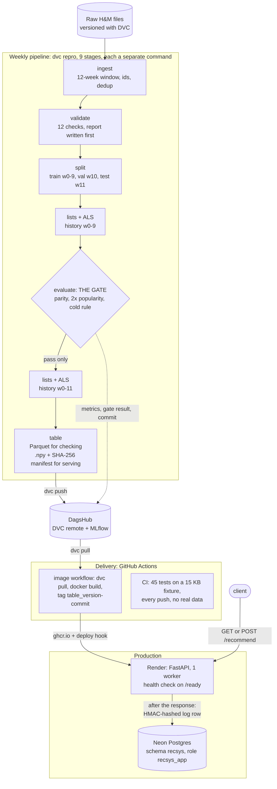
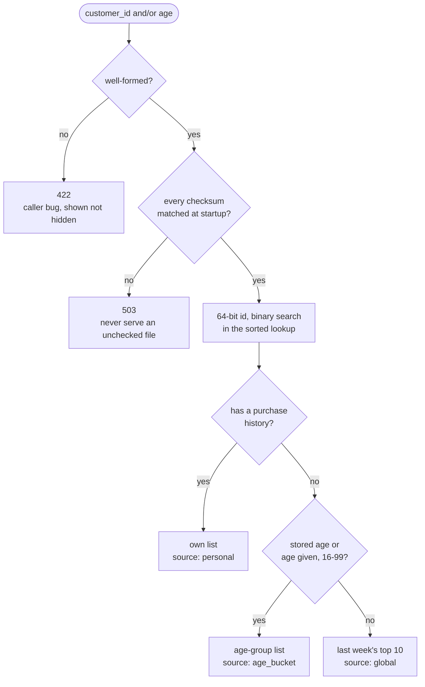

# Weekly fashion recommendations on H&M data

Every week, a reproducible pipeline turns H&M's purchase history into **10 article recommendations for every
customer** (a personal list for the 489,553 customers who bought in the last 12 weeks, an age-group list for
everyone else), checks them against a quality gate, and serves them from a small API in about **0.05 ms per
request** inside the app.

[](https://github.com/suvignan/Recommendation_System/actions/workflows/ci.yml)
**Live API:** https://recommendation-system-bl3v.onrender.com/docs (free tier: the first request after a quiet
period can take 30–60 s while the service wakes up)

```bash
curl "https://recommendation-system-bl3v.onrender.com/recommend?customer_id=ffffffffffffffffffffffffffffffffffffffffffffffffffffffffffffffff&age=25"
```
```json
{"customer_id": "ffff...ffff", "source": "age_bucket",
 "articles": [924243001, 866731001, 909370001, 924243002, 918292001, 923758001, 934835001, 889550002, 762846027, 915529005],
 "items": [{"article_id": 924243001, "name": "Ohlsson (Sweater, Beige)"},
           {"article_id": 866731001, "name": "LANA seamless HW tigths (Leggings/Tights, Black)"}, "...10 in total"],
 "table_version": "e98416179442"}
```

**Try it in the browser:** open `/docs`, pick `GET /recommend` → *Try it out*, and choose one of these real H&M
customer IDs from the **Examples** dropdown (an H&M customer ID is already a 64-character hex string). To try a brand-new
customer, change a few of its letters (0–9, a–f only): the API won't find it and falls back to the age or global list.

| What you'll see | `customer_id` |
|---|---|
| `personal`: bought recently, so gets their own list | `00000dbacae5abe5e23885899a1fa44253a17956c6d1c3d25f88aa139fdfc657` |
| `age_bucket`: no recent purchases, so gets the list for their age group | `00005ca1c9ed5f5146b52ac8639a40ca9d57aeff4d1bd2c5feb1ca5dff07c43e` |
| `global`: no recent purchases and no usable age | `000064249685c11552da43ef22a5030f35a147f723d5b02ddd9fd22452b1f5a6` |

No ID? Use `POST /recommend` with `{"age": 25}` (a new visitor) or `{}` (anonymous) instead.

---

## Results

12 weeks of data (2020-07-01 to 2020-09-22), split by time: train on weeks 0–9, choose on validation (week 10),
report the test week (week 11) **once**, with the system frozen beforehand.

| Model | Validation recall@10 | Test recall / NDCG, all | Test warm | Test cold |
|---|---|---|---|---|
| **Final system (served)** | **0.0495** | **0.0508 / 0.0369** | **0.0625 / 0.0466** | **0.0250 / 0.0157** |
| Repurchase + last-week fill | 0.0457 | 0.0495 / 0.0361 | 0.0619 / 0.0463 | 0.0224 / 0.0136 |
| ALS + last-week fallback | 0.0327 | 0.0343 / 0.0228 | 0.0397 / 0.0270 | 0.0224 / 0.0136 |
| Last-week popularity | 0.0184 | 0.0222 / 0.0145 | 0.0221 / 0.0148 | 0.0224 / 0.0136 |
| Global popularity | 0.0090 | 0.0122 / 0.0082 | 0.0112 / 0.0075 | 0.0146 / 0.0098 |
| Two-tower network (challenger) | 0.0251 | 0.0167 / 0.0112 | 0.0178 / 0.0120 | 0.0142 / 0.0094 |

The final system is **2.7× last-week popularity on validation and 2.3× on test**, and the **top three models kept
their exact order** from validation to test, so the choice made on validation held up on unseen data.

**Reproducible end to end:** a fresh clone on a clean machine, rebuilt from the raw files with `dvc repro --force`
(9 minutes), reproduces the validation recall to the last digit (difference 0.0) and the same serving table,
`table_version` **`e98416179442`**: the same value as the original build, the Docker image tag and the live
`/version`.

- **Warm** = bought something in the history weeks; **cold** = no purchases in the history weeks (31% of test-week
  buyers).
- The final system's numbers use the explicit tie rule described below. Before it, validation was 0.0495 / 0.0368
  and test 0.0507 / 0.0370; the other rows were measured before the rule and are unaffected by it except where
  they include repurchase lists, where the change is below 0.0001.

---

## What's served, and why each part is there

| Customer | Gets | Why |
|---|---|---|
| **Bought in the last 12 weeks** | their **own past purchases**, newest first (at most 10), then **ALS** fills the remaining slots (from 30 candidates, so there are always enough new articles) | Repurchase is the strongest single signal in fashion: a three-line repurchase baseline beat ALS by about 50%. ALS then adds taste-based items: +8% warm recall over a popularity filler on validation |
| **Known, but no purchases in the last 12 weeks** | last week's top 10 **in their age group** (filled up from the global list if a group has fewer than 10) | no recent history to personalise from. Age-group lists beat the global list by **11%** for these customers on validation, so age carries real signal |
| **Unknown visitor** | their age group's list if they give an age (16–99), otherwise the **global** last-week top 10 | the best list available without any information |

Every response says which path it used: `"source": "personal" | "age_bucket" | "global"`, so "why did I get
this?" is answered in the response itself.

---

## Architecture



**One request**, from input to answer (the lookup itself takes about 0.05 ms):



MLflow (on DagsHub) records every pipeline run: settings, recall/NDCG for all/warm/cold, the gate result and the git
commit. CI (GitHub Actions) runs **45 of the 53 tests** on every push, using a 15 KB fixture in the exact raw
format (all 9 stages end to end in about 6 seconds); the other 8 need the real data and run locally.

---

## API

| Endpoint | Purpose |
|---|---|
| `GET /recommend?customer_id=…&age=…` | quick testing from a browser or `curl` |
| `POST /recommend` with `{"customer_id": "…", "age": 25}` | a form: both fields optional, and the id travels in the body, not the URL (so not in access logs) |
| `GET /health` | liveness: the process is running |
| `GET /ready` | readiness: every serving file loaded **and** matched its checksum (the Render health check) |
| `GET /version` | which weekly build is live: table checksum, git commit, history week, build time |

Every answer has exactly 10 distinct articles, a `source` and a `table_version`, plus an `X-Lookup-Ms` header.
A malformed id or an impossible age (< 0 or > 120) is a **422**; an unknown but well-formed id is a normal new
customer. The full rules are in [app/CONTRACT.md](app/CONTRACT.md).

---

## Key design decisions

- **Batch, not real-time.** Nothing in the final system depends on the moment of the request, so the lists are
  precomputed weekly. Computing one warm customer's list at request time took **3.1 ms** with 124 MB of ALS vectors
  in memory; the raw array lookup takes **0.35 µs**. The API needs no model, no pandas and no GPU: the process uses
  **66 MB** (36 MB of NumPy arrays) instead of 410 MB with pandas.
- **An explicit tie rule.** 80% of customers bought 2+ articles on the same day, and their order came from row
  position in the file. Rule (chosen before measuring): same date or same count → smaller `article_id` first. It
  reshuffled two thirds of the lists and moved validation recall by less than 0.0001, so the result wasn't luck
  from file order, and the table is now identical on any row order (same SHA-256 on every rebuild).
- **Snapshot parity vs a live gate.** On this frozen snapshot the pipeline must reproduce the notebook's recall to
  1e-6 (it does: difference 0.0). That check also caught a change the live gate would have missed: one extra ALS
  iteration moved recall by 2.2e-5. In a live weekly run a fixed number means nothing, so the gate compares against
  **last-week popularity scored in the same run**: the system must be **at least 2.0×** popularity (validation 2.69×,
  test 2.29×; losing the repurchase part drops it to 1.55–1.78×), and cold customers must beat popularity. A softer
  **warning** flags the ALS filler if it stops beating a popularity filler (1.08× on validation, only 1.01× on test,
  so a hard rule would fail on normal weeks).
- **Checksums and `/ready`.** The serving manifest stores a SHA-256 for every file. At startup the API recomputes
  them; one wrong byte and it stays alive but not ready, and `/recommend` returns 503. Render's health check is
  `/ready`, so a container with a bad file never gets traffic. A test changes one byte and proves it.
- **One shared Postgres, isolated by schema and role.** One Neon database hosts three projects. This one lives in
  schema `recsys`, and the API connects as `recsys_app`, a role with rights only there: reading another project's
  table fails with `permission denied` (tested). Logging runs after the response and can never fail a request.
- **HMAC, not plain hashing.** Logged customer ids are `HMAC-SHA256(secret, id)`. Plain SHA-256 could be reversed by
  hashing all 1.37M known ids; without the key, nobody can.
- **Two formats for the table.** Long Parquet for checking and comparing (golden-file tests); dense `.npy` arrays
  for serving (a request is one row read). Customer ids are stored as 64-bit numbers (10 MB instead of 94 MB of
  text); the pipeline refuses to build if two customers would collide.
- **Tests that prove different things.** Golden files prove the pipeline equals the validated notebooks; small
  hand-written tests prove the logic itself is right. The fixture found two real bugs that 3 million real rows
  never showed, including one that could have served a non-existent article 0.

---

## The two-tower challenger (built, measured, not served)

**What I built:** a user tower (customer id + age group + club status + news frequency) and an item tower (article
id + product code, product type, colour, section, price…), trained in Keras with in-batch softmax. **16.1M
parameters**, and **99.9% of the user tower is the customer-id embedding**.

**Training choices, each with its reason:**
- **Temperature 0.05:** dot products of normalised vectors sit in [−1, 1]; without sharpening, the softmax over the
  batch stays nearly flat and can't become confident.
- **Accidental hits:** about **8% of rows in each batch shared their article with another row**, so that customer's
  own purchase also appeared as a "negative" in another column. Those cells are masked instead of punished.
- **logQ correction:** popular articles appear as negatives far more often, so the model would learn to push them
  down just for being frequent; subtracting log(frequency) during training removes that bias (Yi et al., 2019).
- **Early stopping on validation recall, not loss:** the loss kept improving for 9 epochs after recall stopped.
- **Overfit test first:** one batch, loss from **6.4 to 0.0005**, proving the model and loss could learn at all.

**The cold-start collapse:** as training went on, **cold-customer recall fell from 0.0114 to 0.0015**. Diagnosis:
every unknown customer maps to id row 0, which never appears in training, so it never receives a gradient and stays
random, while the network learns to rely more and more on the id. **ID dropout** (randomly hiding 20% of training
ids, so row 0 learns "unknown customer" and the other features must carry signal) brought cold recall back to
about **0.016**. That was still below popularity (0.0194), and simple age-group popularity (0.0216) showed the
features do carry signal the network didn't capture.

**Results and the decision:** best validation recall 0.0251 against the final system's 0.0495; as a filler inside
the blend it also lost to ALS; on the test week 0.0167 (it was frozen at week 9, so it couldn't see the newest
week's customers). The decision rules were **written before the runs**, and it met neither, so it isn't served.

**What it's good at:** catalogue coverage of **33–41%** of articles against ALS's **9.4%**, and its nearest
neighbours group colour variants of the same product and similar product types: it learned real structure.

**Where it would earn its place, and the next experiment:** request-time context (session clicks, the item just
viewed), which a precomputed table can't use. My hypothesis is that the customer-id embedding dominates and
memorises; the experiment is a **user tower with no customer id at all**.

---

## How to run it

The H&M data comes from the Kaggle competition *H&M Personalized Fashion Recommendations* and isn't included in this
repo; it's versioned with DVC on DagsHub.

```bash
git clone https://github.com/suvignan/Recommendation_System.git && cd Recommendation_System
python -m venv .venv && .venv/Scripts/activate          # Windows; source .venv/bin/activate elsewhere
pip install -r requirements.txt && pip install -e .
dvc remote modify origin --local auth basic
dvc remote modify origin --local user <dagshub-user>
dvc remote modify origin --local password <dagshub-token>
dvc pull                       # raw data + every stage's outputs
dvc status                     # "Data and pipelines are up to date"
pytest                         # all 53 tests (CI runs the 45 that need no real data: pytest -m "not data")
dvc repro                      # the pipeline (only stages whose inputs changed)
docker build -t recsys-api . && docker run -p 8000:8000 recsys-api     # then http://localhost:8000/docs
```

Without `RECSYS_DATABASE_URL` and `RECSYS_HASH_KEY` set, the API runs with logging switched off.

## How to retrain each week

1. Put the new raw files in `data/RAW`, then `dvc add data/RAW`.
2. In `params.yaml`, move the 12-week window forward one week (`window.start_date`), and set the
   snapshot-only values to `null` (`expected_rows`, `gate.reference_recall`), so the live gate (lift over popularity)
   decides instead of the frozen-snapshot parity check.
3. `dvc repro`: validation and the gate stop the run if the data or the model is wrong.
4. **`dvc push` first, then `git push`** (the image workflow starts on the push and pulls the new table).
5. GitHub Actions builds `recsys-api:<table_version>-<commit>` (and `latest`), then calls Render's deploy hook,
   so the new build goes live with no manual step.
6. **Rollback:** redeploy the previous image tag (Render → Events → Rollback). Each image carries its own
   checksummed table, and `/version` shows exactly which build is live.

---

## Repository map

```
config/schema.yaml        what the raw data must look like (the contract)
params.yaml               every choice, traceable to the notebook where it was made
src/recsys/components/    the 9 pipeline stages
src/recsys/utils/         metrics, shared serving helpers (id hashing, age buckets, checksums)
app/                      FastAPI lookup service and its contract (app/CONTRACT.md)
notebooks/01–09           the evidence: EDA, split, baselines, ALS, two-tower, blend, test day, tie rule
tests/                    golden-file, hand-written, fixture smoke and API tests
```

---

## Limitations and future work

- **One test week only.** A single week can be unusual; a rolling evaluation over several weeks would be stronger.
- **Offline evaluation only.** These results replay history; the real test is an online A/B test on live traffic.
- **New articles can't be recommended** until they have sales: every list is built from past purchases. The item
  tower could embed them from their features, which is a reason to keep the network as a challenger.
- **The window is set by hand** in `params.yaml`; deriving it from the newest date in the data would remove a
  manual step from the weekly run.
- **The API has no authentication or rate limiting** (it's a public portfolio demo).
- **The free tier sleeps,** and latency from my laptop is p50 757 ms / p95 2.7 s, almost all of it network:
  `/health`, which does nothing, already takes about 530 ms, while the lookup itself is 0.05 ms.
- **The "ID dominates" hypothesis is untested** (the no-id user tower above).
- **Notes learned the hard way:** run `dvc push` before `git push`; a wrong DagsHub login shows up as "missing
  cache files", so the image workflow checks the secrets first.